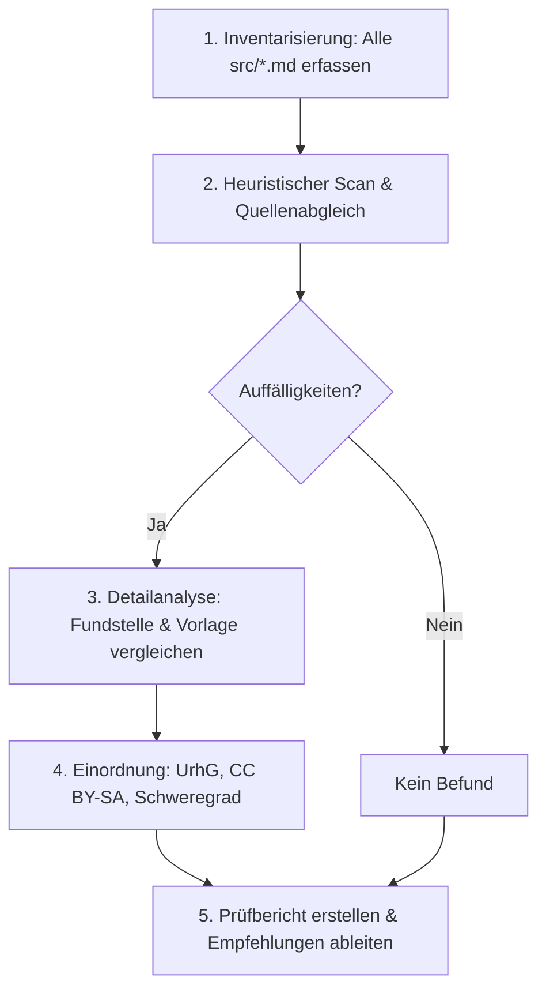

# Urheberrechts-Prüfung (Wiki-Audit)

Diese Skill leitet Coding- und Redaktions-Agenten (Codex, Antigravity/agy, Claude Code) an, alle Inhaltsseiten dieses Wikis (`src/*.md`) systematisch auf potenzielle Urheberrechtsverletzungen und Plagiate zu überprüfen.

---

## 1. Auftrag & Zielsetzung

Überprüfe alle Markdown-Inhalte dieses Wikis unter `src/` auf:
1. **Wörtliche Übernahmen:** Textpassagen, die identisch oder nur mit marginalen Änderungen aus externen Quellen übernommen wurden.
2. **Eng angelehnte Paraphrasen:** Absätze, die Satzbau, Gedankenführung oder ungewöhnliche Metaphern/Formulierungen einer Vorlage ohne hinreichenden Abstand (§ 23 UrhG) nachahmen.
3. **Übersetzte Passagen:** Aus fremdsprachigen Texten (z. B. englischer Wikipedia, fremdsprachigen Fachartikeln) unautorisiert oder ungekennzeichnet ins Deutsche übertragene Abschnitte.
4. **Fehlende oder fehlerhafte Attribution:** Fehlende Namensnennung / Lizenzhinweise bei Nachnutzung freier Werke (insb. Wikipedia unter CC BY-SA 4.0) oder unzulässige Übernahmen aus geschützten Quellen („Alle Rechte vorbehalten").

Am Ende erzeugt der Agent einen **strukturierten Prüfbericht** mit Fundstellen (Dateipfad, Zeilennummer, Textzitat), vermuteter Quelle, Befundart, Schweregrad und Handlungsempfehlung.

---

## 2. Rechtliche Leitlinien & Bewertungskriterien

Die Prüfung stützt sich auf die rechtlichen Grundsätze des deutschen Urheberrechtsgesetzes (UrhG) sowie die redaktionellen Richtlinien des Co-Wikis (vgl. [`src/urheberrecht-und-duplicate-content.md`](../../../src/urheberrecht-und-duplicate-content.md)):

| Aspekt | Rechtliche Einordnung | Bewertung im Wiki |
|---|---|---|
| **Schöpfungshöhe (§ 2 Abs. 2 UrhG)** | Nur persönliche geistige Schöpfungen genießen Urheberrechtsschutz als Sprachwerk. | Individuelle Prosa, Beschreibungen, Essays und Zeitungsberichte sind geschützt. |
| **Fakten & Tatsachen** | Reine Tatsachen (Daten, Zahlen, Chronologie, Wahlergebnisse, historische Ereignisse) sind gemeinfrei. | **Keine Verletzung:** Gleiche Fakten mit eigener Gliederung und eigenen Worten sind urheberrechtlich unbedenklich. |
| **Amtliche Werke (§ 5 UrhG)** | Gesetze, amtliche Verordnungen und Bekanntmachungen (z. B. heraldische Blasonierung von Wappen aus der Kommunalen Wappenrolle) sind urheberrechtsfrei. | Zitate amtlicher Blasonierungen sind zulässig; Verweis auf Herkunft ist guter Stil. |
| **Hinreichender Abstand (§ 23 UrhG)** | Bearbeitungen oder Umformulierungen bedürfen der Einwilligung, wenn kein hinreichender innerer und äußerer Abstand zum Original gewahrt wird (ehem. freie Benutzung gem. § 24 a. F. entfallen). | Enge Paraphrasen, die nur Synonyme einsetzen oder Sätze umstellen, sind unzulässig. |
| **Wikipedia & CC BY-SA 4.0** | Weiternutzung und Bearbeitung zulässig, erfordert aber zwingend: 1. Autorennennung (Link), 2. Lizenzangabe (CC BY-SA 4.0), 3. Änderungshinweis, 4. Share-Alike. | Seiten mit Wikipedia-Substanz müssen den Block `## Wikipedia als Quelle` vor dem Transparenzhinweis enthalten. |
| **Geschützte Facharchive & Regionalquellen** | Quellen mit „Alle Rechte vorbehalten" (z. B. **Stormarn-Lexikon**, Hamburger Abendblatt, Stormarner Tageblatt, MARKT Ahrensburg, lokale Chroniken). | **Strikte Richtlinie:** Niemals Text daraus übernehmen, umschreiben oder übersetzen! Nur sachliche Verlinkung als Weblink zulässig. |
| **Zitatrecht (§ 51 UrhG)** | Wörtliche Wiedergabe nur bei echtem Zitatzweck (Beleg/Auseinandersetzung), unverändert, im gebotenen Umfang mit Quellenangabe (§ 63 UrhG). | Zitate müssen typografisch als Zitat erkennbar sein (`>` oder Anführungszeichen) und die Quelle nennen. |

---

## 3. Klassifizierung nach Schweregrad

Jeder gefundene Verdachtsfall wird in eine von drei Stufen eingeteilt:

### 🔴 HOCH (Kritisch – Sofortiger Handlungsbedarf)
- Wörtliche Textübernahmen (> 4-5 aufeinanderfolgende signifikante Wörter) aus **urheberrechtlich geschützten Quellen** („Alle Rechte vorbehalten", insb. Stormarn-Lexikon, lokale Zeitungsartikel, Sachbücher).
- Sehr eng angelehnte Paraphrasen ohne hinreichenden Abstand aus geschützten Quellen.
- Ungekennzeichnete Übersetzungen fremdsprachiger geschützter Texte.
- Subzielle Übernahmen aus Wikipedia **ohne jeglichen Attributionsblock** (Verletzung der Lizenz CC BY-SA 4.0).

### 🟡 MITTEL (Nachbearbeitung erforderlich)
- Engere Paraphrasen aus Wikipedia trotz vorhandenem Herkunftshinweis, bei denen der Text eigenständiger formuliert werden sollte, um Qualitätsstandards zu sichern.
- Unvollständiger Attributionsblock bei Wikipedia-Nutzung (z. B. fehlender Lizenzlink oder fehlender Änderungshinweis).
- Längere Zitate, bei denen der Zitatzweck (§ 51 UrhG) unklar ist oder die Anführungszeichen/Quellenangabe unvollständig sind.
- Stark textnahe Paraphrasen nicht-amtlicher Webseiten.

### 🟢 NIEDRIG (Hinweis / Redaktionelle Empfehlung)
- Reine Tatsachenüberschneidung mit geringfügigen Formulierungskoinzidenzen bei Standardfloskeln.
- Veralteter oder formatmäßig abweichender Link im Attributionsblock.
- Interne Textdopplungen (Duplicate Content zwischen zwei `src/`-Seiten im Wiki), die durch gegenseitige Verlinkung bereinigt werden sollten.

---

## 4. Prüfprozess für den Agenten

Folge bei der Ausführung dieser Skill diesem strukturierten Ablauf:



### Schritt 1: Dateibestand ermitteln
- Alle Inhaltsdateien unter `src/**/*.md` erfassen.
- `src/SUMMARY.md` als Referenzkatalog hinzuziehen.
- Ausgeschlossen von inhaltlicher Urheberrechtsrüge:
  - Technische Konfigurationen (`book.toml`).
  - Reine Datenschutz-/Impressums-Pflichttexte (`src/datenschutz.md`, `src/impressum.md`), sofern sie Standard-Rechtstexte sind.
  - Generierte Spiegelungen (`src/openwiki/*`), die aus Repo-Quellcode generiert werden.

### Schritt 2: Screening & Heuristiken (Such- und Analyseschritte)
Nutze gezielte Werkzeuge (Shell-Befehle, `grep_search`, Web-Recherche, n-Gram-Vergleiche):
1. **Suche nach bekannten sensiblen Quellen:**
   - Prüfe Erwähnungen oder Weblinks zu `stormarn-lexikon.de`, Zeitungsarchiven (`abendblatt.de`, `shz.de`) etc.
   - Stelle sicher: Werden diese nur verlinkt, oder wurde Text übernommen?
2. **Attributions-Check Wikipedia:**
   - Welche Seiten enthalten den Block `## Wikipedia als Quelle`?
   - Enthält der Block: Link zum Wikipedia-Artikel, Versions-/Autorenhinweis, Lizenzlink (`CC BY-SA 4.0`), Hinweis auf redaktionelle Bearbeitung?
3. **Stichprobenartige Web-/Textsuche für markante Phrasen:**
   - Für charakteristische, bildhafte oder lange Sätze: Exakte Phrasensuche über Websuche oder Abgleich mit Wikipedia-Artikeln zur Stadt Ahrensburg, Ortsteilen, Bauwerken.

### Schritt 3: Detailanalyse (Absatz für Absatz)
Untersuche auffällige Textstellen anhand der Kriterien:
- Liegt eine wörtliche Kette vor (> 4 signifikante Wörter identisch)?
- Wurde nur die Wortstellung vertauscht oder wurden triviale Synonyme eingesetzt?
- Handelt es sich um bloße Fakten (z. B. „1949 erhielt Ahrensburg das Stadtrecht") oder um geschützte sprachliche Gestaltung?

### Schritt 4: Schweregrad zuweisen
Ordne jeden Fund präzise in `HOCH`, `MITTEL` oder `NIEDRIG` ein.

### Schritt 5: Prüfbericht ausgeben
Erstelle den Bericht gemäß der Vorlage in Abschnitt 5.

---

## 5. Vorlage für den Prüfbericht

Gib das Ergebnis in folgendem strukturierten Markdown-Format aus:

```markdown
# Prüfbericht: Urheberrechts- und Plagiatsprüfung

**Datum:** [JJJJ-MM-TT]
**Geprüfter Bereich:** `src/*.md` ([Anzahl] Dateien)
**Ergebnisübersicht:**
- 🔴 HOCH (Kritisch): [Anzahl]
- 🟡 MITTEL (Nachbearbeitung empfohlen): [Anzahl]
- 🟢 NIEDRIG (Hinweise / Formalia): [Anzahl]

---

## Übersicht der auffälligen Seiten

| Datei | Fundstelle (Zeile) | Vermutete Quelle / Vorlage | Art des Befunds | Schweregrad |
|---|---|---|---|---|
| `src/...` | Z. 45–52 | [Quellenname/URL] | Wörtliche Übernahme / Paraphrase / Lizenz | 🔴 / 🟡 / 🟢 |

---

## Detaillierte Befunde & Handlungsempfehlungen

### 1. `src/[datei].md`

- **Fundstelle:** Zeilen [X–Y], Abschnitt `## [Überschrift]`
- **Text im Wiki:**
  > „[Auszug aus der Wiki-Seite]"
- **Vermutete Vorlage / Quelle:**
  > „[Auszug oder URL der externen Quelle]"
- **Befundart:** Wörtliche Übernahme / Eng angelehnte Paraphrase / Fehlende Attribution
- **Schweregrad:** 🔴 HOCH / 🟡 MITTEL / 🟢 NIEDRIG
- **Begründung:** [Warum stellt dies ein Problem dar? z. B. Stormarn-Lexikon ist urheberrechtlich geschützt; Wikipedia-Lizenz CC BY-SA 4.0 nicht erfüllt]
- **Handlungsempfehlung:** [Konkreter Vorschlag: Absatz komplett neu und unabhängig verfassen / Zitat formatieren / Attributionsblock ergänzen / Absatz ersatzlos streichen]

---

## Zusammenfassung & Nächste Schritte

[Kompakte Empfehlung für die Redaktion: Welche Schritte müssen vor dem nächsten Deploy (`npm run ver`) zwingend umgesetzt werden.]
```

---

## 6. Typische Hilfsbefehle für die Durchführung

Die folgenden Befehle unterstützen die Analyse im Terminal:

```bash
# 1. Alle Markdown-Dateien im Inhaltsverzeichnis src/ auflisten
find src -maxdepth 2 -name "*.md" | sort

# 2. Seiten mit vorhandener Wikipedia-Attribution finden
git grep -l "Wikipedia als Quelle" src/

# 3. Externe Erwähnungen sensibler Quellen (z. B. Stormarn-Lexikon) prüfen
git grep -in "stormarn-lexikon" src/

# 4. Nach Zitaten suchen (§ 51 UrhG)
git grep -in '^>' src/

# 5. Typische Phrasen aus der Wikipedia-Einleitung Ahrensburg prüfen
git grep -in "liegt im Südosten von Schleswig-Holstein" src/
```

---

## 7. Wichtige Verhaltensregeln für Agenten

- **Niemals selbstständig Dateien überschreiben oder löschen**, solange die Prüfung läuft. Der Bericht bereitet die Entscheidung vor.
- **Transparenz:** Unterscheide immer klar zwischen gesicherten Treffern und bloßen Verdachtsmomenten.
- **Fakten vs. Sprache:** Rüge keine Fakten. Wenn zwei Texte dieselben historischen Jahreszahlen oder Einwohnerzahlen nennen, ist das normal und legal. Rüge die Übernahme der sprachlichen Schöpfung.
- **Ressourcenschonung:** Scanne effizient und lies bei Detailprüfungen nur die betroffenen Zeilenausschnitte (Scoped Reading).
